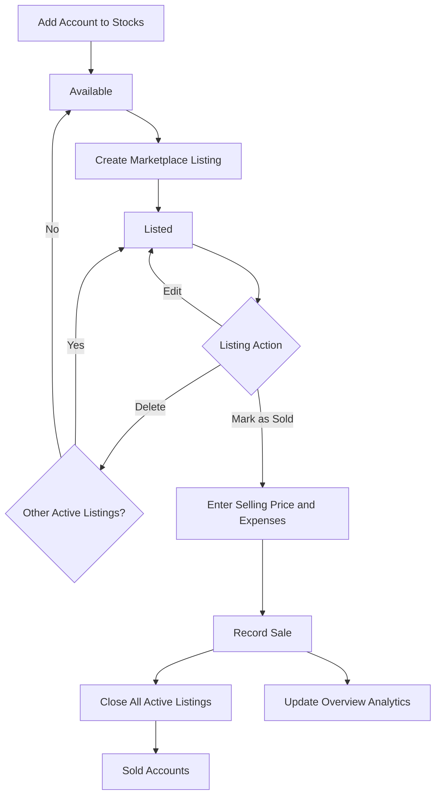
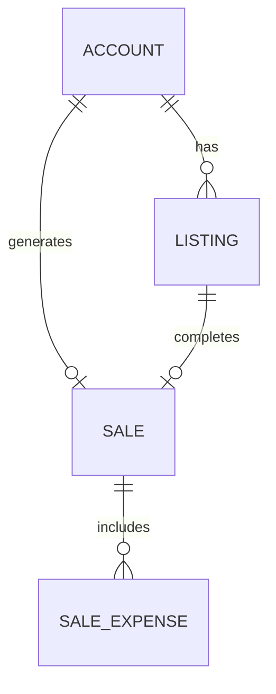

<div align="center">

# AccStacks

**Stack Accounts. Track Profits.**

A centralized management system for game account resellers.

Manage inventory, organize marketplace listings, record sales, and track business performance — all in one workspace.


</div>

---

## About

**AccStacks** is a game account trading management system designed to simplify the day-to-day operations of game account resellers. Instead of managing accounts, listings, and financial records across spreadsheets, notes, and multiple marketplaces, AccStacks brings everything into a single dashboard.

AccStacks is an internal business management tool, not a public marketplace. It helps resellers track their external listings and sales without requiring direct marketplace integrations.

## Core Features

### Overview

A centralized dashboard for monitoring inventory and business performance.

- Total, available, listed, and sold accounts.
- Active marketplace listings and current inventory value.
- Total revenue, cost of goods sold, additional expenses, and net profit.
- Profit margin and sales performance over time.
- Recent transactions and performance by game and marketplace.
- Date range filters for financial analytics.

### Stocks

Manage purchased game accounts throughout their entire lifecycle.

- Add accounts with game name, account name, description, and purchase price.
- Organize inventory into All Accounts, Available, Listed, and Sold Accounts.
- Search, filter, sort, and edit account records.
- View purchase information and associated marketplace listings.
- Display sold accounts with a dimmed appearance and a clear `SOLD` badge.
- Preserve sold account records and their transaction history.

### Listings

Manage listings across multiple external marketplaces from one workspace.

- Create listings directly from existing stock accounts.
- Enter custom marketplace names, such as Instagram, Facebook, Shopee, or Itemku.
- Set individual listing prices and optionally attach listing URLs.
- List the same account on multiple marketplaces simultaneously.
- View estimated profit before a sale.
- Edit, delete, or mark active listings as sold.

### Sales & Profit Tracking

Record completed sales and automatically calculate their financial results.

- Enter the actual selling price, even if it differs from the listing price.
- Record optional expenses, such as marketplace fees, middleman fees, or transfer fees.
- Calculate net profit, profit margin, and return on investment (ROI).
- Automatically close all active listings associated with a sold account.
- Move sold accounts into the Sold Accounts category.
- Preserve historical sales data and prevent duplicate sales.
- Automatically update dashboard statistics after a completed sale.

> Closing a listing in AccStacks does not remove it from an external marketplace. External listings must be removed manually.

## Account Lifecycle



| Status | Description |
| :--- | :--- |
| `AVAILABLE` | In stock with no active listings. |
| `LISTED` | Has at least one active marketplace listing. |
| `SOLD` | Successfully sold and retained in transaction history. |

## Financial Calculations

AccStacks is designed to distinguish listing estimates from actual financial results.

```text
Estimated Profit = Listing Price - Purchase Price
Revenue          = Actual Selling Price
Net Profit       = Revenue - Purchase Price - Additional Expenses
Profit Margin    = (Net Profit / Revenue) x 100%
ROI              = (Net Profit / Purchase Price) x 100%
```

Profit margin and ROI are undefined when their respective denominators are zero. Loss-making sales are valid transactions and must remain part of the financial history.

### Example Transaction

| Description | Amount |
| :--- | ---: |
| Purchase price | Rp500.000 |
| Listing price | Rp850.000 |
| Actual selling price | Rp800.000 |
| Additional expenses | Rp25.000 |
| **Net profit** | **Rp275.000** |
| **Profit margin** | **34.38%** |
| **ROI** | **55.00%** |

All monetary values use Indonesian Rupiah (IDR) by default.

## Planned Tech Stack

| Layer | Technology |
| :--- | :--- |
| Framework | Next.js (App Router) |
| Language | TypeScript |
| Styling | Tailwind CSS |
| UI Components | shadcn/ui |
| Icons | Lucide |
| Data Visualization | Recharts |
| Database | PostgreSQL |
| ORM | Prisma |
| Validation | Zod |
| Deployment | Docker / Self-hosted VPS |

## Planned Data Model



- **Account** — game, account information, purchase cost, and inventory status.
- **Listing** — marketplace, listing price, external URL, and listing status.
- **Sale** — completed transaction with a snapshot of purchase cost, actual selling price, and financial results.
- **Sale Expense** — itemized additional costs associated with a sale.

## Getting Started

The project is currently in development. The technology stack and features described in this README represent the intended implementation. Local installation, environment configuration, database migration, and deployment instructions will be added once the repository implementation is available.

## Roadmap

- [ ] Application layout and responsive dashboard
- [ ] Database schema and inventory management
- [ ] Multi-marketplace listing management
- [ ] Sales confirmation and transaction history
- [ ] Revenue and profit analytics
- [ ] Search, filters, and sorting
- [ ] Authentication and private data protection
- [ ] Dark and light themes
- [ ] CSV export for inventory and sales
- [ ] Automated tests and Docker deployment

## Security & Responsible Use

AccStacks is intended to manage business records, not game account credentials. Do not store passwords, recovery codes, or other sensitive login information in account descriptions or notes. Private inventory and financial data should be protected by authentication before deployment.

Users are responsible for ensuring their transactions comply with applicable game publisher policies, marketplace terms, and local regulations. AccStacks is not affiliated with any game publisher or marketplace.

## License

A license has not been specified. Refer to the repository's `LICENSE` file if one is added.

---

<div align="center">

**AccStacks** — Stack Accounts. Track Profits.

Developed by **Wardana Dev**.

</div>
