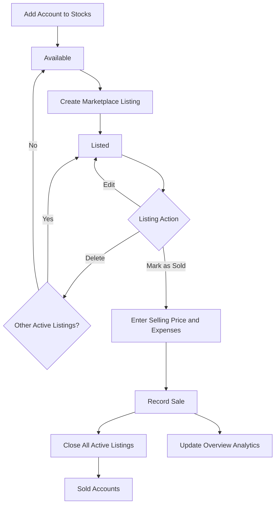
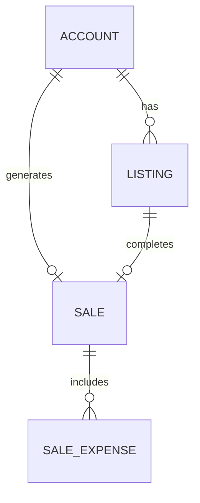

<div align="center">

# AccStacks

**Stack Accounts. Track Profits.**

A centralized management system for game account resellers.

Manage inventory, organize marketplace listings, record sales, and track business performance — all in one workspace.


</div>

---

## About

**AccStacks** is a game account trading management system designed to simplify the day-to-day operations of game account resellers. Instead of managing accounts, listings, and financial records across spreadsheets, notes, and multiple marketplaces, AccStacks brings everything into a single dashboard.

AccStacks is an internal business management tool, not a public marketplace. It helps resellers track their external listings and sales without requiring direct marketplace integrations.

## Core Features

### Overview

A compact business snapshot that separates today's position from completed sales in the selected reporting period.

- Total, available, listed, and sold accounts.
- Active marketplace listings and current inventory value.
- Owner capital, retained profit, estimated cash, and estimated equity.
- Realized net profit, total revenue, margin, and comparison with the prior period when a baseline exists.
- A compact sales chart, top games, sale averages, and recent transactions linked to Sold Accounts.

### Analytics

Use the same reporting periods to investigate what drove sales results.

- Cost of goods sold, additional expenses, ROI, and previous-period comparisons.
- Monthly sales, detailed game profitability, and marketplace revenue.
- Current estimated unrealized profit and inventory holding age, independent of the sales period.
- CSV exports of the selected financial period or all completed sales.

### Stocks

Manage purchased game accounts throughout their entire lifecycle.

- Add accounts with game name, account name, description, purchase price, and private local thumbnails.
- Use expanded popular-game autocomplete or enter a custom game.
- Automatically allocate collision-safe game-prefixed account IDs and linked listing IDs.
- Organize inventory into All Accounts, Available, Listed, and Sold Accounts.
- Search, filter, sort, and edit account records, with a default Available → Listed → Sold order and alphabetical names within each status.
- View purchase information and associated marketplace listings.
- Display sold accounts with a dimmed appearance and a clear `SOLD` badge.
- Review immutable transaction snapshots in the Sold Accounts table and export completed sales.

### Listings

Manage listings across multiple external marketplaces from one workspace.

- Create listings directly from existing stock accounts.
- Enter custom marketplace names, such as Instagram, Facebook, Shopee, or Itemku.
- Set individual listing prices and optionally attach listing URLs.
- List the same account on multiple marketplaces simultaneously without duplicate inventory cards.
- Expand a multi-listing account at the top of the grid with unstack motion to manage every independent marketplace listing and linked listing ID, then use Close all to restore the stack; single listings show direct actions.
- View estimated profit before a sale.
- Edit, delete, or mark active listings as sold.

### Sales & Profit Tracking

Record completed sales and automatically calculate their financial results.

- Enter the actual selling price, even if it differs from the listing price.
- Record optional expenses, such as marketplace fees, middleman fees, or transfer fees.
- Calculate net profit, profit margin, and return on investment (ROI).
- Automatically close all active listings associated with a sold account.
- Move sold accounts into the Sold Accounts category.
- Preserve historical sales data and prevent duplicate sales.
- Automatically update dashboard statistics after a completed sale.

> Closing a listing in AccStacks does not remove it from an external marketplace. External listings must be removed manually.

## Account Lifecycle



| Status | Description |
| :--- | :--- |
| `AVAILABLE` | In stock with no active listings. |
| `LISTED` | Has at least one active marketplace listing. |
| `SOLD` | Successfully sold and retained in transaction history. |

## Financial Calculations

AccStacks is designed to distinguish listing estimates from actual financial results.

```text
Estimated Profit = Listing Price - Purchase Price
Revenue          = Actual Selling Price
Net Profit       = Revenue - Purchase Price - Additional Expenses
Profit Margin    = (Net Profit / Revenue) x 100%
ROI              = (Net Profit / Purchase Price) x 100%
```

Profit margin and ROI are undefined when their respective denominators are zero. Loss-making sales are valid transactions and must remain part of the financial history.

### Example Transaction

| Description | Amount |
| :--- | ---: |
| Purchase price | Rp500.000 |
| Listing price | Rp850.000 |
| Actual selling price | Rp800.000 |
| Additional expenses | Rp25.000 |
| **Net profit** | **Rp275.000** |
| **Profit margin** | **34.38%** |
| **ROI** | **55.00%** |

Choose IDR or USD the first time you enter a new workspace. That choice applies to capital, purchases, listings, sales, analytics, and exports. Existing workspaces keep IDR; there is no currency conversion.

## Tech Stack

| Layer | Technology |
| :--- | :--- |
| Framework | Next.js (App Router) |
| Language | TypeScript |
| Styling | Tailwind CSS |
| UI Components | shadcn/ui |
| Icons | Lucide |
| Data Visualization | Recharts |
| Database | PostgreSQL |
| ORM | Prisma |
| Validation | Zod |
| Deployment | Docker / Self-hosted VPS |

## Data Model



- **Account** — game, account information, purchase cost, and inventory status.
- **Listing** — marketplace, listing price, external URL, and listing status.
- **Sale** — completed transaction with a snapshot of purchase cost, actual selling price, and financial results.
- **Sale Expense** — itemized additional costs associated with a sale.

## Getting Started

### Prerequisites

- Node.js 24 or a compatible current LTS release.
- pnpm 11.18.0 (the repository pins this version through Corepack).
- Docker Engine/Desktop with Docker Compose for PostgreSQL.
- Git Bash, macOS, Linux, or an equivalent shell for the example commands.

### Local installation

1. Install dependencies:

   ```bash
   pnpm install
   ```

2. Create `.env` from `.env.example` and replace every placeholder. Generate independent authentication secrets with:

   ```bash
   node -e "console.log(require('node:crypto').randomBytes(32).toString('base64url'))"
   ```

3. Start development PostgreSQL and apply migrations:

   ```bash
   docker compose up -d db
   pnpm db:migrate
   ```

4. Start the application:

   ```bash
   pnpm dev
   ```

   Open `http://localhost:3000` and select **Create account** to register with an email and password, or **Sign in** if you already have an account. Registration opens your private workspace; enter starting capital once to finish setup. Zero is valid.

5. Optional: Provision a specific workspace owner from the terminal by setting `OWNER_NAME`, `OWNER_EMAIL`, and a unique strong `OWNER_PASSWORD` in `.env`:

   ```bash
   pnpm auth:create-owner
   ```

   This command updates the password if the configured email already exists. For sample data, set the `SEED_OWNER_*` variables and run `pnpm db:seed` only when explicitly wanted; it is blocked in production and skips inserting records when the demo owner already has stock.

### Automated checks

Create the isolated test database once (the default development credentials are shown; adjust for your environment):

```bash
docker exec accstacks-db-1 createdb -U accstacks accstacks_test
```

Set `TEST_DATABASE_URL` to that database, install Chromium with `pnpm exec playwright install chromium`, then run:

```bash
pnpm format:check
pnpm lint
pnpm typecheck
pnpm test:unit
pnpm test:integration
pnpm test:e2e
pnpm build
```

Integration and E2E tests always require a database name ending in `_test`; development and production data are never valid test targets.

### Production and reference documentation

- [Docker and HTTPS deployment](docs/deployment.md)
- [Database backup and restoration](docs/backup-restore.md)
- [Financial calculation and lifecycle rules](docs/financial-rules.md)
- [Contribution workflow](CONTRIBUTING.md)
- [Agent engineering rules](AGENTS.md)

## Roadmap

- [x] Application layout and responsive dashboard
- [x] Database schema and inventory management
- [x] Multi-marketplace listing management
- [x] Sales confirmation and transaction history
- [x] Revenue and profit analytics
- [x] Search, filters, and sorting
- [x] Authentication and private data protection
- [x] Light theme by default, with dark and system theme options
- [x] CSV export for inventory and sales
- [x] Automated tests and Docker deployment

## Security & Responsible Use

The landing page and registration are public; inventory, listings, sales, and reports are private to the workspace owner. Registration uses rate-limited email and password credentials. Email verification and self-service password recovery are not available.

AccStacks is intended to manage business records, not game account credentials. Do not store passwords, recovery codes, or other sensitive login information in account descriptions or notes. Private inventory and financial data should be protected by authentication before deployment.

Users are responsible for ensuring their transactions comply with applicable game publisher policies, marketplace terms, and local regulations. AccStacks is not affiliated with any game publisher or marketplace.

## License

A license has not been specified. Refer to the repository's `LICENSE` file if one is added.

---

<div align="center">

**AccStacks** — Stack Accounts. Track Profits.

Developed by **Wardana Dev**.

</div>
